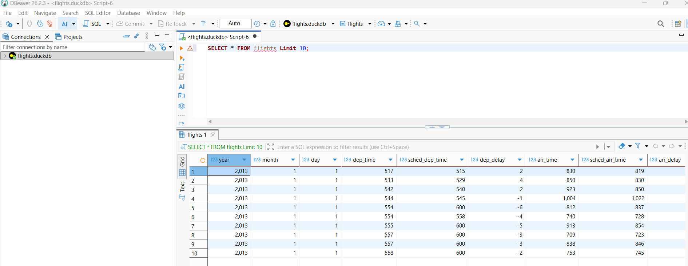
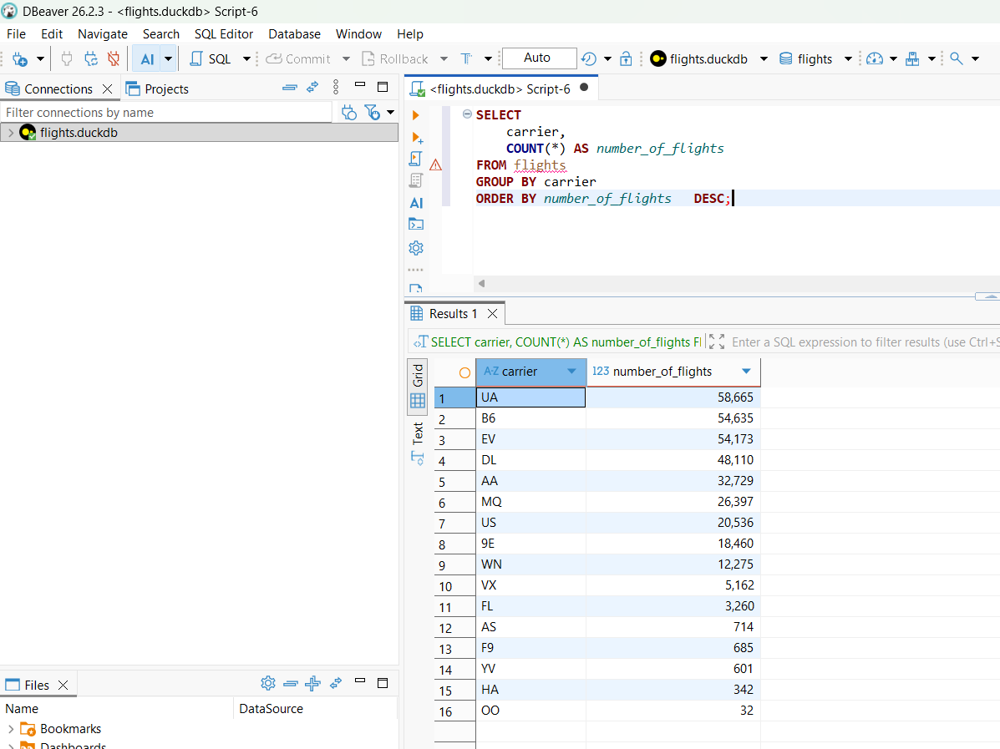
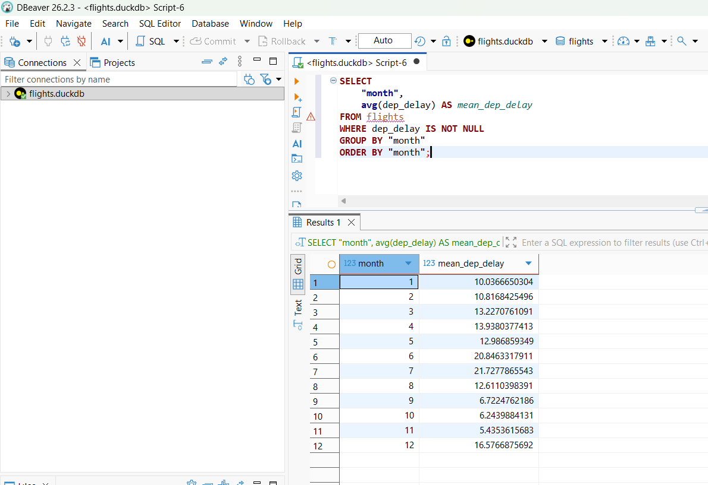
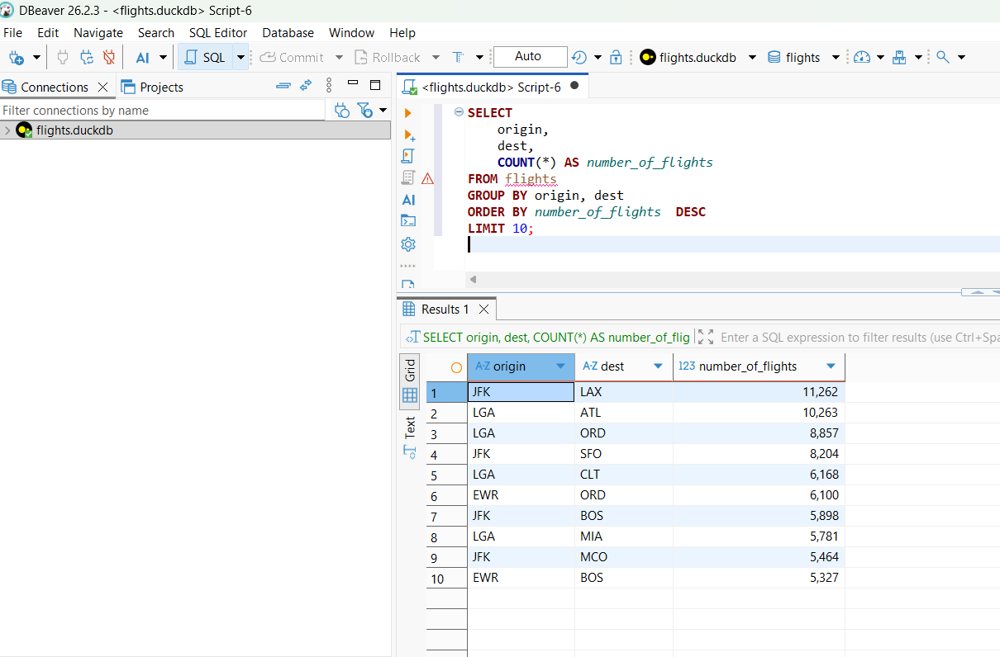

```{r setup, include=FALSE}
knitr::opts_chunk$set(echo       = TRUE, 
                      fig.align  = "center",
                      fig.height = 3, fig.width = 4)
ggplot2::theme_set(ggplot2::theme_bw() + ggplot2::theme(strip.background = ggplot2::element_rect(fill = "white")))
```

# Part I: Answers

## Setup 

### Explanation

I loaded the necessary packages, downloaded the `DuckDB` file from the provided URL, and opened a Duckdb connection called **`con`**. I then checked if the connection is working.

```{r}
#| warning: false
#| message: false

#Load Packages DBI, duckdb, nycflights13 and anything else you need
library(DBI)
library(duckdb)
library(tidyverse)
library(nycflights13)

# Download the DuckDB file from the provided URL

url <- "https://data-science-master.github.io/lectures/data/flights.duckdb"

download.file(url, destfile = "../data/flights.duckdb", mode = "wb")

#Open Duckdb connection
con <- dbConnect(duckdb(dbdir = "../data/flights.duckdb", read_only = TRUE))

#Checkconnection
dbIsValid(con)
```

## a. List the first 10 rows of the `flights` table.

### Explanation

Using the `{sql, connection=con}` header, I executed a SQL query to fetch all columns from the `flights` table, limiting the results to the first 10 rows.

```{sql, connection=con}

-- select all columns from the flights table and stop at 10 rows

SELECT * 
  FROM flights
  LIMIT 10;
```

## b. Find the number of flights

### Explanation

The `COUNT(*) AS` command was essential because it counts rows and assigns the result a new column name. Part I counted all rows in the `flights` table, while Part II required grouping and sorting the results in **descending order**. I also used `max.print = -1` in the chunk header for part II to display all carriers. There were a total of **336, 776 flights** in the table and the number of flights for each carrier is shown below.

### i. in the data set

```{sql, connection=con}
-- count the total number of rows in the flight table and return the result as "total number of flights"

SELECT Count(*) AS "total_number_of_flights"
FROM flights;
```

### ii. for each carrier

```{sql, connection=con, max.print = -1}

--select the carrier column from flights and count the rows, then group the count by carrier and order by the number of flights in descending order 

SELECT "carrier", Count(*) AS "number_of_flights"
FROM flights
GROUP BY "carrier"
ORDER BY "number_of_flights" DESC;
```

## c. Find the average departure delay (`dep_delay`)

### Explanation

The `AVG("") AS ""` summary function was used to calculate the average departure delay and report it as "mean_dep_delay". The average departure delay was **12.64 minutes.**

```{sql, connection=con}
 -- calculate the average departure delay and report it as "mean_dep_delay"
 
SELECT AVG("dep_delay") AS "mean_dep_delay" 
FROM flights;
```

## d. Find the top 5 destinations (`dest`) With the most flights.

### Explanation

The number of rows from the `dest` column was counted. The result was grouped by flights and then reported in descending order bu the count. The output was limited to 5 rows to select the top 5 destinations. According to the results the top 5 destinations in descending order are **Chicago, Atlanta, Los Angeles, Boston, and Orlando.**

```{sql, connection=con}
-- count rows in dest and report them as number of flights after grouping by dest and ordering  them by the count in descending order, return the first 5 rows

SELECT "dest", Count(*) AS "number of flights"
FROM flights
GROUP BY "dest"
ORDER BY "number of flights" DESC
LIMIT 5;
```

## 

## e. Create a table showing: `carrier,`average arrival delay (`arr_delay`)

### Explanation

The query selected the `carrier` column and calculated the average arrival delay in a new column called `mean_arr_delay`. The results were grouped by carrier and sorted by the calculated averages in **descending order**. I also added `output.var="carrier_tibble"` to the chunk header to assign the results as a table. I then called the object to display the tibble.

```{sql, connection=con, output.var="carrier_tibble"}
-- select carrier anc calculate average arr-delay excluding NAs, group by

SELECT "carrier", AVG("arr_delay") AS "mean_arr_delay"
FROM flights
WHERE "arr_delay" IS NOT NULL
GROUP BY "carrier"
ORDER BY "mean_arr_delay" DESC;
```

```{r}

# show tibble from the previous query
carrier_tibble
```

## Closing the Connection

```{r}
# close connection and check 

DBI::dbDisconnect(con, shutdown = TRUE) 
dbIsValid(con)
```

# Part II: Answers

## a. List the first 10 rows of the `flights` table.

### Explanation

I followed the instructions to download **DBeaver**, connect to the `flights.duckdb` database, and create a new SQL file. I selected all columns from the `flights` table and limited the output to the first 10 rows. Although the query executed successfully as shown in the screenshot below, I am still unsure why DBeaver displayed the message “Table flights not found.”



## b. Find the **number of flights** for each carrier.

### Explanation

I used the same commands from Part 1b to the execute the query in Dbeaver.



## c. Find the average departure delay by month

### Explanation

I used a query similar to Part 1e, with a few key differences. I selected the `month` column and calculated the average departure delay using `dep_delay`. The results were then grouped by month and ordered by the calculated average departure delays.

{alt="Part 2C solution screenshot"}

## d. Find the top 10 routes (`dest`) by: `origin,dest`ordered by number of flights.

### Explanation

The `origin` and `dest` columns were selected to identify each route, and the number of flights for each route was counted in a new column called `number_of_flight`. Grouping by `origin` and then `dest` identified each unique route combination. The results were sorted by the flight count in descending order, and `LIMIT 10` was used to report the top 10 routes.


